

  

<h3> 🚀 念安-Echo | 🌈 Full Stack Developer | 📌 SuZhou </h3>
  
<a href="https://dandan1232.github.io/"><b>🌐 个人网站 · 作品集与技术笔记 ↗</b></a>

  <!-- 敲代码动图 -->
  <!--  -->
    

   

  <!-- 社交徽章 -->
  

    &emsp;&emsp;
    &emsp;&emsp;
   &emsp;&emsp;
    &emsp;&emsp;
    

  

  
<b>Technology has the power to make the world a better place</b>

  

---

## 👋 Hi! Nice to meet you!

### 🎉About me
- 💡 I’m **@念安 (Echo)** — a full-stack developer based in **Suzhou, China**  
- 🔭 Passionate about **AI, digital life, and innovative coding projects**  
- 🌱 Always curious and eager to explore new technologies and creative ideas  
- 🎯 Enjoy **building interesting projects and pushing boundaries**
- 📫 If you need any help, you can contact me via WeChat: **waitu1232**

### 🌟 When I’m not coding, you’ll probably find me:  
- 📚 Reading books to gain fresh perspectives  
- 🌍 Exploring the world and experiencing new cultures  
- ✨ Thinking about how technology can blend into everyday life
- 🎲 Anything fun
---

## Project Collection

Click a card to view my projects.

<!-- 卡片使用固定宽度和行内排版，在 GitHub 中随可用宽度自然换行。 -->

  <a href="https://github.com/dandan1232/mai-recap">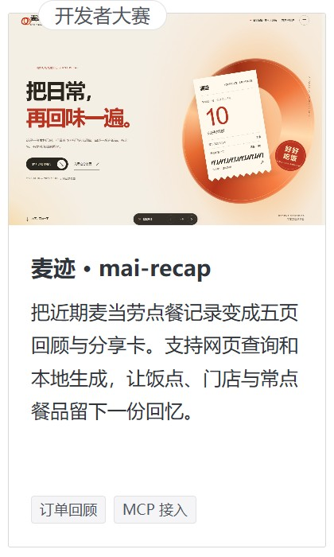</a>
  <a href="https://github.com/dandan1232/transformer-layerscape">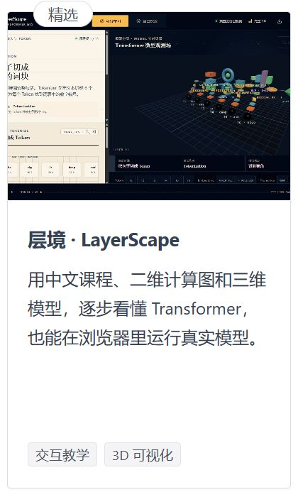</a>
  <a href="https://github.com/dandan1232/NarratorAI">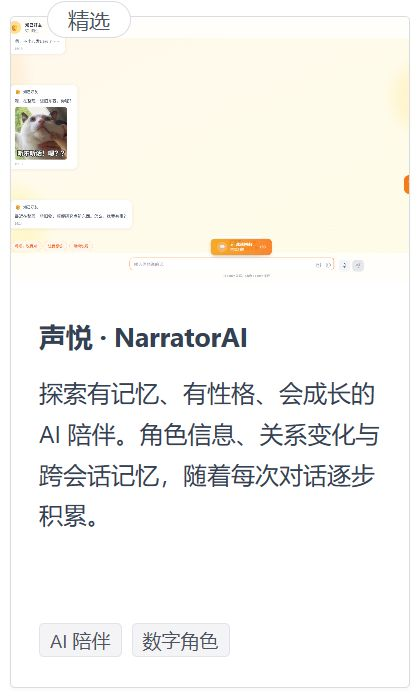</a>
  <a href="https://github.com/dandan1232/reminder-anything-uniapp">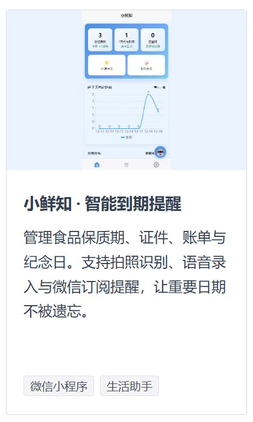</a>
  <a href="https://github.com/SparkAgentForge/flowguard-ai/tree/main">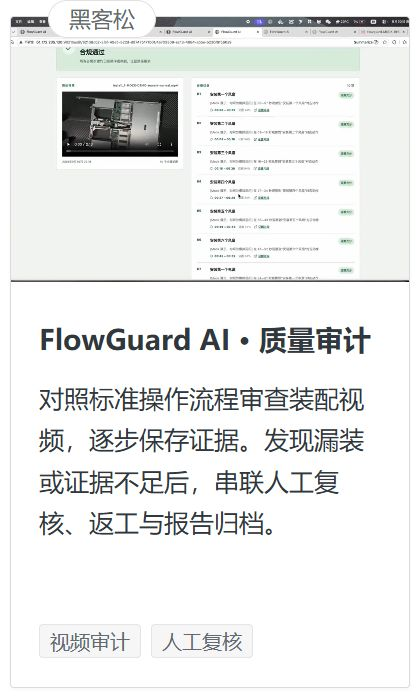</a>
  <a href="https://github.com/dandan1232/LearnSphere">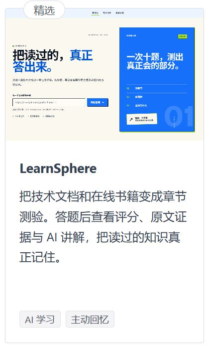</a>
  <a href="https://github.com/dandan1232/CollabDocs">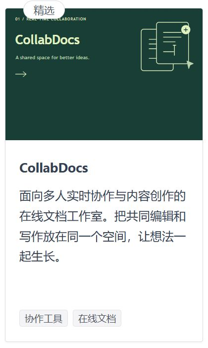</a>
  <a href="https://github.com/dandan1232/evidence-bureau">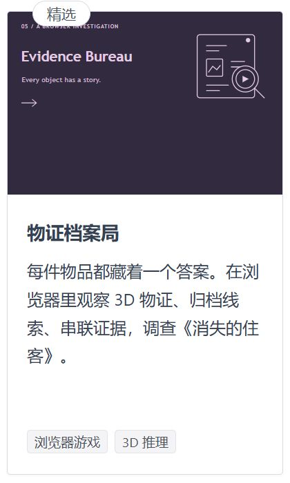</a>
  <a href="https://github.com/dandan1232/JobTailor">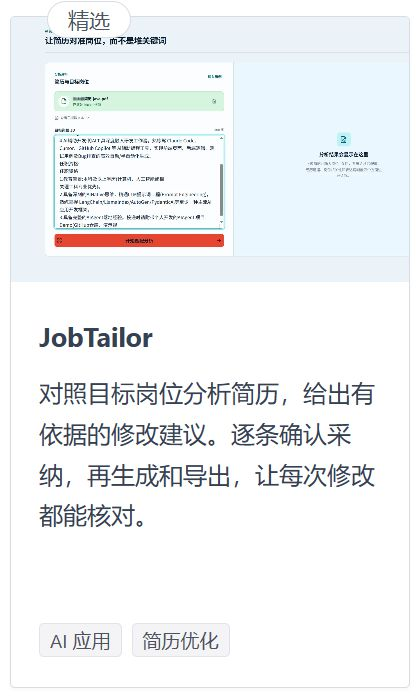</a>
  <a href="https://github.com/dandan1232/ConvertKit">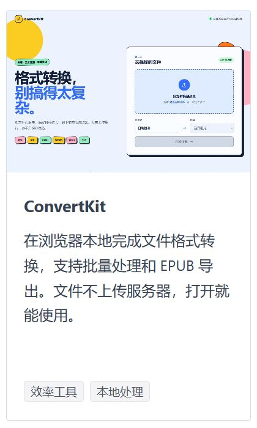</a>
  <a href="https://github.com/dandan1232/Just-Like-This">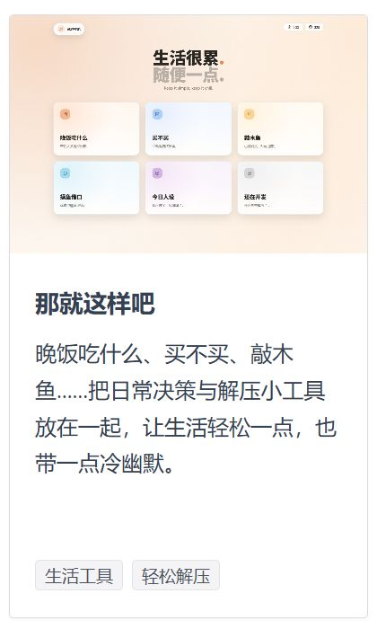</a>
  <a href="https://github.com/dandan1232/heartcloud-live">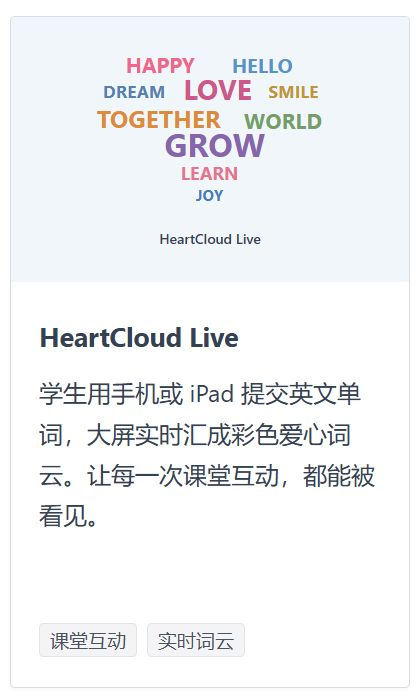</a>
  <a href="https://github.com/dandan1232/raiden_pause">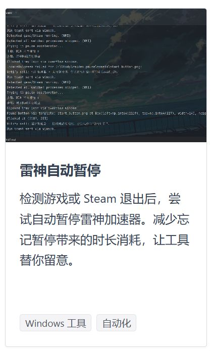</a>

项目索引与在线入口

| 项目 | 简介 | 入口 |
| :--- | :--- | :--- |
| 麦迹 · mai-recap | 把近期麦当劳点餐记录变成五页回顾与分享卡。支持网页查询和本地生成，让饭点、门店与常点餐品留下一份回忆。 | [源码](https://github.com/dandan1232/mai-recap) · [在线体验 ↗](https://mai-recap.vercel.app/) |
| 层境 · LayerScape | 用中文课程、二维计算图和三维模型，逐步看懂 Transformer，也能在浏览器里运行真实模型。 | [源码](https://github.com/dandan1232/transformer-layerscape) · [在线体验 ↗](https://tl.nianan.ggff.net/) |
| 声悦 · NarratorAI | 探索有记忆、有性格、会成长的 AI 陪伴。角色信息、关系变化与跨会话记忆，随着每次对话逐步积累。 | [源码](https://github.com/dandan1232/NarratorAI) · [在线体验 ↗](https://narrator-ai-five.vercel.app/) |
| 小鲜知 · 智能到期提醒 | 管理食品保质期、证件、账单与纪念日。支持拍照识别、语音录入与微信订阅提醒，让重要日期不被遗忘。 | [源码](https://github.com/dandan1232/reminder-anything-uniapp) |
| 黑客松 · FlowGuard AI | 对照标准操作流程审查装配视频，逐步保存证据。发现漏装或证据不足后，串联人工复核、返工与报告归档。 | [源码](https://github.com/SparkAgentForge/flowguard-ai/tree/main) |
| LearnSphere | 把技术文档和在线书籍变成章节测验。答题后查看评分、原文证据与 AI 讲解，把读过的知识真正记住。 | [源码](https://github.com/dandan1232/LearnSphere) · [在线体验 ↗](https://learnsphere.nianan.ggff.net/) |
| CollabDocs | 面向多人实时协作与内容创作的在线文档工作室。把共同编辑和写作放在同一个空间，让想法一起生长。 | [源码](https://github.com/dandan1232/CollabDocs) · [在线体验 ↗](https://collabdoc.nianan.ggff.net/) |
| 物证档案局 | 每件物品都藏着一个答案。在浏览器里观察 3D 物证、归档线索、串联证据，调查《消失的住客》。 | [源码](https://github.com/dandan1232/evidence-bureau) |
| JobTailor | 对照目标岗位分析简历，给出有依据的修改建议。逐条确认采纳，再生成和导出，让每次修改都能核对。 | [源码](https://github.com/dandan1232/JobTailor) · [在线体验 ↗](https://job.nianan.ggff.net/) |
| ConvertKit | 在浏览器本地完成文件格式转换，支持批量处理和 EPUB 导出。文件不上传服务器，打开就能使用。 | [源码](https://github.com/dandan1232/ConvertKit) |
| 那就这样吧 | 晚饭吃什么、买不买、敲木鱼……把日常决策与解压小工具放在一起，让生活轻松一点，也带一点冷幽默。 | [源码](https://github.com/dandan1232/Just-Like-This) · [在线体验 ↗](https://just-like-this.vercel.app/) |
| HeartCloud Live | 学生用手机或 iPad 提交英文单词，大屏实时汇成彩色爱心词云。让每一次课堂互动，都能被看见。 | [源码](https://github.com/dandan1232/heartcloud-live) |
| 雷神自动暂停 | 检测游戏或 Steam 退出后，尝试自动暂停雷神加速器。减少忘记暂停带来的时长消耗，让工具替你留意。 | [源码](https://github.com/dandan1232/raiden_pause) · [Windows 下载](https://github.com/dandan1232/raiden_pause/releases/tag/v1.0) |

## 🛠️ Tech Stack

| 技术方向 | 技术栈 |
| :--- | :--- |
| **编程语言** | Python · Java · JavaScript · TypeScript |
| **前端开发** | Vue.js · React · Next.js · Vite |
| **后端开发** | FastAPI · Spring Boot · Node.js · API Integration |
| **数据库与存储** | PostgreSQL · MySQL · Neo4j · OceanBase · 向量数据库 · IndexedDB |
| **AI 开发** | FastGPT · LangChain · Transformers · spaCy · AI Agent Workflows · Digital Human Applications |
| **RAG 与知识图谱** | RAG · GraphRAG · LightRAG · Embedding · Reranking · BGE-M3 · BGE Reranker |
| **实时协作** | WebSocket · Tiptap · Yjs |
| **3D 可视化** | Three.js · React Three Fiber |
| **小程序开发** | uni-app · Vue 3 · 微信小程序 API · 微信云开发 |
| **开发与部署** | Git · Linux / WSL · Docker · Docker Compose · GitHub Actions |
| **测试工具** | Vitest · Playwright |

---

## 🌿 Areas I’m Currently Exploring

- 🚀 Passionate about AI, Knowledge Graphs, and RAG systems
- 🌱 Continuously improving my system design and distributed systems skills
- 🤖 Currently building digital human solutions for Computex, including interactive exhibition experiences and AI digital business cards
- ✈️ Inspired by travel, exploration, and the intersection of technology and real-world experiences
- 🤝 Excited to share my learning journey and collaborate with awesome people

---

  

---

## 📈 GitHub Stats
<!-- 两张卡片稳定并排：用表格控制布局 -->

  

<table align="center">
  <tr>
    <td>
      
    </td>
    <td>
      
    </td>
  </tr>
</table>

<table>
  <tr>
    <td>
      <picture>
        <source media="(prefers-color-scheme: dark)" srcset="https://github-readme-activity-graph.vercel.app/graph?username=dandan1232&theme=xcode&bg_color=FF000000&hide_border=true" />
        <source media="(prefers-color-scheme: light)" srcset="https://github-readme-activity-graph.vercel.app/graph?username=dandan1232&theme=xcode&bg_color=FF000000&color=000000&hide_border=true" />
        
      </picture>
  </tr>
</table>

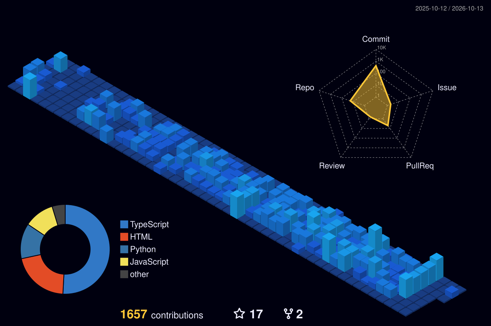

